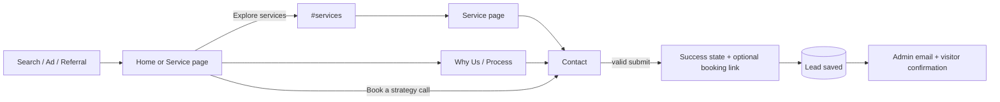
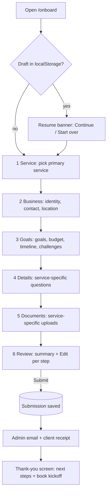

# App Flow Document

**Project:** Skopos Codex · v0.1 · 2026-10-21

---

## 1. Sitemap

```
/
├── #services (anchor)
├── /services
│   ├── /local-seo
│   ├── /ppc
│   ├── /branding
│   ├── /website-design
│   └── /funnel-building
├── /process
├── /why-us
├── /contact
├── /onboard
├── /privacy
├── /terms
└── /admin            (auth required)
    ├── /admin/leads/[id]
    └── /admin/onboarding/[id]
```

## 2. Global navigation

| Element | Target |
|---------|--------|
| Logo | `/` |
| Services ▾ | dropdown of 5 service pages (mobile: accordion in menu) |
| Process | `/process` |
| Why Us | `/why-us` |
| Onboard | `/onboard` |
| Get in touch (button) | `/contact` |
| Footer — Services | 5 service pages |
| Footer — Company | `/process`, `/why-us`, `/contact`, `/privacy` |
| Footer CTA "Book a Free Call" | `/contact` |
| Footer legal | `/privacy`, `/terms` |

## 3. Primary user journeys

### 3.1 Prospect → Lead (main conversion)



**Contact page states**

| State | UI |
|-------|----|
| Idle | Empty form, required markers |
| Typing | Inline validation on blur |
| Invalid submit | Errors listed, focus moves to first invalid field, screen reader announcement |
| Submitting | Button disabled + spinner, "Sending…" |
| Success | Form replaced by "Thanks, {name} — we'll reply within 24 hours" + "Pick a time now" link |
| Server error | Toast + form kept intact, "Try again" / email fallback |
| Rate-limited | "Too many attempts, try again later" |

### 3.2 Signed client → Onboarding



**Wizard rules**

- **Continue** validates only the current step; errors block advance.
- **Back** never loses data.
- Step indicator: completed steps are clickable; future steps are not.
- Progress % = completed steps / 6.
- Changing the service in step 1 after step 4 is filled shows a confirm dialog ("Details for the old service will be cleared").
- Draft autosaves (debounced 500 ms) to `localStorage` key `onboard-draft-v1`; cleared on successful submit.
- Uploads start immediately on file selection; Continue is disabled while an upload is in progress; failed uploads show Retry.
- Step 6 Submit is idempotent (client-generated `submissionId`) so double-clicks don't duplicate.

### 3.3 Admin → Act on leads

```mermaid
flowchart LR
  E[Notification email] --> L[/admin login: magic link/]
  L -->|allow-listed email| D[Dashboard: Leads | Onboarding tabs]
  L -->|not allowed| X[Access denied]
  D --> LD[Lead detail]
  LD --> ST[Change status / add note]
  D --> OD[Onboarding detail]
  OD --> F[Download files via signed URL]
  D --> CSV[Export CSV]
```

## 4. Page-level flow (section order)

### Home `/`
Header → Hero (badge → `/process`, CTAs → `/contact`, `#services`) → Growth dashboard card → Value statements → Services grid → Industries ticker → Process teaser (5 steps, 97% retention) → Why choose us (4 pillars + What you get, CTA → `/contact`) → Results counters → Closing CTA (→ `/contact`, `/why-us`) → Footer

### Service page `/services/[slug]`
Hero (CTA → `/contact?service=slug`, "See what's included" → `#included`) → Outcomes (3) → Deliverables (6) + timeline → Framework (5 steps) → Stats + case study → FAQ (6) → Closing CTA → More services (4 others) → Footer

> `?service=slug` pre-selects the dropdown on `/contact`.

### Process `/process`
Hero + 97% stat → 5 step blocks (tagline, description, 4 deliverables, timeline) → FAQ (5) → CTA (→ `/contact`, `/why-us`)

### Why Us `/why-us`
Hero → Statement banner → 6 differentiators → Comparison table (Typical vs Us) → Results counters (4) → Testimonials (3) → What you get + Senior strategists → CTA (→ `/contact`, `/process`)

### Contact `/contact`
Intro → Form | Contact info card → What to expect (4) → FAQ (4)

## 5. Analytics events

| Event | Fired when | Properties |
|-------|-----------|------------|
| `cta_click` | Any primary CTA | `location`, `label`, `href` |
| `lead_submitted` | Contact success | `service` |
| `onboarding_started` | Step 1 continue | `service` |
| `onboarding_step_completed` | Each continue | `step`, `service` |
| `onboarding_file_uploaded` | Upload success | `slot`, `size` |
| `onboarding_submitted` | Final submit | `service`, `durationSec` |
| `faq_open` | Accordion opened | `page`, `question` |

## 6. Error & edge flows

| Case | Behaviour |
|------|-----------|
| Unknown route | Branded 404 with links to Home, Services, Contact |
| JS disabled | All content and counter values render; contact form posts via server action progressive enhancement |
| Storage upload fails | Retry ×3, then error with "Email files instead" fallback |
| Email provider down | Submission still saved; failure logged; admin sees it in `/admin` |
| Session expired in admin | Redirect to login, then back to original URL |
