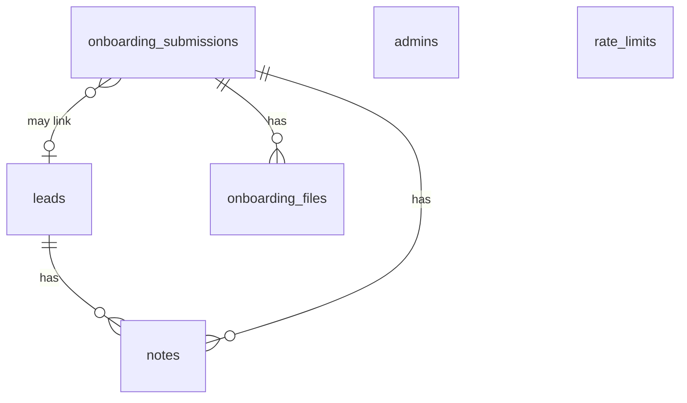

# Backend Schema

**Project:** Skopos Codex · v0.1 · 2026-10-21
**Database:** Supabase Postgres 15 · **Storage:** Supabase Storage

---

## 1. Design decisions

- **Leads** are flat columns (small, fixed form, easy to filter/export).
- **Onboarding answers** are stored as `jsonb` per step. The form has ~130 service-specific questions that will change often; the zod schema in `src/lib/schemas/onboarding.ts` is the source of truth and validates before insert. Only fields we filter on (service, business name, email, budget, status) are promoted to columns.
- **Files** get their own table so admins can list and sign downloads without parsing JSON.
- RLS on every table; the public never reads. Server actions write with the service-role key.

## 2. Entity diagram



## 3. Enums

```sql
create type service_type as enum
  ('local_seo', 'ppc', 'branding', 'website_design', 'funnel_building', 'not_sure');

create type lead_status as enum
  ('new', 'contacted', 'qualified', 'won', 'lost', 'spam');

create type onboarding_status as enum
  ('submitted', 'in_review', 'kickoff_scheduled', 'active', 'archived');
```

## 4. Tables

```sql
-- Contact form submissions
create table leads (
  id           uuid primary key default gen_random_uuid(),
  created_at   timestamptz not null default now(),
  full_name    text not null check (char_length(full_name) between 1 and 120),
  email        citext not null check (email ~* '^[^@\s]+@[^@\s]+\.[^@\s]+$'),
  phone        text check (char_length(phone) <= 40),
  company      text check (char_length(company) <= 160),
  service      service_type not null,
  message      text not null check (char_length(message) between 1 and 5000),
  status       lead_status not null default 'new',
  source_page  text,                      -- e.g. /services/ppc
  utm          jsonb not null default '{}', -- utm_source, utm_medium, utm_campaign...
  ip_hash      text,                      -- salted sha256, never raw IP
  user_agent   text
);
create index leads_created_at_idx on leads (created_at desc);
create index leads_status_idx on leads (status);
create index leads_email_idx on leads (email);

-- Onboarding wizard submissions
create table onboarding_submissions (
  id              uuid primary key,          -- client-generated -> idempotent upsert
  created_at      timestamptz not null default now(),
  updated_at      timestamptz not null default now(),
  service         service_type not null check (service <> 'not_sure'),
  status          onboarding_status not null default 'submitted',
  -- promoted for filtering
  business_name   text not null,
  contact_name    text not null,
  contact_email   citext not null,
  contact_phone   text,
  website_url     text,
  monthly_budget  text,
  -- answers by step (validated by zod before insert)
  business        jsonb not null,            -- step 2
  goals           jsonb not null,            -- step 3
  details         jsonb not null,            -- step 4 (shape depends on service)
  schema_version  int  not null default 1,
  lead_id         uuid references leads(id) on delete set null,
  ip_hash         text
);
create index onboarding_created_at_idx on onboarding_submissions (created_at desc);
create index onboarding_service_idx on onboarding_submissions (service);
create index onboarding_status_idx on onboarding_submissions (status);

-- Uploaded documents (step 5)
create table onboarding_files (
  id             uuid primary key default gen_random_uuid(),
  submission_id  uuid not null references onboarding_submissions(id) on delete cascade,
  slot           text not null,              -- e.g. 'logo', 'brand_guidelines'
  storage_path   text not null unique,       -- onboarding/{submission_id}/{slot}/{uuid}-{name}
  file_name      text not null,
  mime_type      text not null,
  size_bytes     int  not null check (size_bytes <= 26214400), -- 25 MB
  created_at     timestamptz not null default now()
);
create index onboarding_files_submission_idx on onboarding_files (submission_id);

-- Internal notes on leads or submissions
create table notes (
  id             uuid primary key default gen_random_uuid(),
  created_at     timestamptz not null default now(),
  author_email   citext not null,
  lead_id        uuid references leads(id) on delete cascade,
  submission_id  uuid references onboarding_submissions(id) on delete cascade,
  body           text not null check (char_length(body) <= 5000),
  check ((lead_id is null) <> (submission_id is null))  -- exactly one parent
);

-- Staff allow-list for /admin
create table admins (
  email      citext primary key,
  created_at timestamptz not null default now()
);

-- Simple fixed-window rate limiter
create table rate_limits (
  key          text not null,               -- e.g. 'contact:{ip_hash}'
  window_start timestamptz not null,
  count        int not null default 0,
  primary key (key, window_start)
);
```

Required extensions: `pgcrypto`, `citext`.

`updated_at` trigger on `onboarding_submissions`.

## 5. Row-level security

```sql
alter table leads                   enable row level security;
alter table onboarding_submissions  enable row level security;
alter table onboarding_files        enable row level security;
alter table notes                   enable row level security;
alter table admins                  enable row level security;
alter table rate_limits             enable row level security;

create function is_admin() returns boolean
language sql stable security definer set search_path = public as $$
  select exists (select 1 from admins where email = (auth.jwt() ->> 'email')::citext);
$$;

-- Admin read/update; no anon policies => public cannot read or write.
create policy admin_all on leads                  for all using (is_admin()) with check (is_admin());
create policy admin_all on onboarding_submissions for all using (is_admin()) with check (is_admin());
create policy admin_all on onboarding_files       for all using (is_admin()) with check (is_admin());
create policy admin_all on notes                  for all using (is_admin()) with check (is_admin());
create policy admin_read on admins                for select using (is_admin());
-- rate_limits: service role only (no policies)
```

Inserts from public forms go through server actions using the **service-role key**, after zod validation, Turnstile and rate limiting.

**Rate limiting:** `hit_rate_limit(p_key text, p_window_seconds int, p_max int) returns boolean` atomically increments a fixed-window counter in `rate_limits` and returns `true` while the key is within `p_max` hits. Execute is revoked from `public`, so only the service role can call it. The contact form uses key `contact:{ip_hash}`, 5 per hour.

## 6. Storage

| Bucket             | Public | Policy                                                                                            |
| ------------------ | ------ | ------------------------------------------------------------------------------------------------- |
| `onboarding-files` | No     | Uploads only via server-issued signed upload URLs; reads only by admins via signed URLs (10 min). |

Allowed MIME: `application/pdf`, `image/png`, `image/jpeg`, `image/svg+xml`, `image/webp`, `application/zip`, `application/postscript` (AI), `application/vnd.openxmlformats-officedocument.wordprocessingml.document`. Max 25 MB/file, 10 files/submission.

## 7. Onboarding payload (zod source of truth)

Step 1 sets `service`. Steps 2–3 are shared; step 4 and step 5 slots depend on the service. `*` = required.

### Step 2 — Business (`business` jsonb)

`businessName*`, `contactName*`, `email*`, `phone*`, `websiteUrl`, `industry*`, `primaryCategory*`, `yearsInBusiness`, `employees`, `businessDescription*`, `streetAddress`, `city*`, `state*`, `zip`, `country*`, `serviceAreas`

### Step 3 — Goals (`goals` jsonb)

`primaryGoal*`, `biggestChallenge*`, `idealCustomer*`, `differentiator`, `monthlyBudget*`, `timeline*`, `startDate`, `workedWithAgency` (bool), `previousAgency`, `previousAgencyOutcome`, `doNotTarget`

### Step 4 — Details (`details` jsonb, discriminated by `service`)

| Service             | Fields                                                                                                                                                                                                                                                                                                                              |
| ------------------- | ----------------------------------------------------------------------------------------------------------------------------------------------------------------------------------------------------------------------------------------------------------------------------------------------------------------------------------- |
| **local_seo**       | `gbpUrl`, `gbpVerified` (yes/no/unsure), `reviewCount`, `avgRating`, `napConsistent` (yes/no/unsure), `targetKeywords*` (5–10), `currentMainKeywordRank`, `topCompetitors*` (3), `competitorsDoBetter`, `seoTools`                                                                                                                  |
| **ppc**             | `platforms*` (Google, Meta, Microsoft, LinkedIn, TikTok, YouTube), `ranAdsBefore` (bool), `previousSpend`, `previousResults`, `mediaBudget*`, `targetCpa`, `aov_ltv`, `conversionTrackingSetUp` (yes/no/unsure), `trackingPixels`, `googleAdsId`, `metaBusinessId`, `primaryConversionGoal*`, `targetGeography*`, `landingPageUrls` |
| **website_design**  | `currentPlatform`, `hostingProvider`, `domainRegistrar`, `currentProblems`, `requiredPages*`, `requiredFeatures`, `integrations`, `copyReady` (yes/no/partial), `photography` (have/need), `sitesYouLove*`, `stylesYouHate`, `designAesthetic`, `monthlyTraffic`                                                                    |
| **funnel_building** | `funnelType*`, `hasLeadMagnet` (bool), `leadMagnetDescription`, `currentLeadSources`, `monthlyLeadVolume`, `closeRate`, `salesCycle`, `dropOffPoint`, `crm`, `crmOther`, `hasEmailList` (bool), `automationNeeded`, `bookingTool`, `paymentProcessor`, `funnelBuilder`, `currentLandingPages`                                       |
| **branding**        | `brandingWork*` (logo, identity, guidelines, naming, rebrand…), `brandAge`, `currentBrandProblems`, `mission`, `brandPromise`, `currentTagline`, `personality*` (≤ 3), `positioning`, `colorDirection`, `primaryColors`, `brandFonts`, `brandsYouAdmire`, `competitorBrands`, `deliverableFormats*`                                 |

### Step 5 — Document slots (`onboarding_files.slot`)

| Service             | Slots                                                                              |
| ------------------- | ---------------------------------------------------------------------------------- |
| **local_seo**       | `logo`, `gbp_screenshots`, `business_photos`, `keyword_rankings`                   |
| **ppc**             | `past_campaign_reports`, `brand_assets`, `landing_page_files`                      |
| **website_design**  | `logo`, `brand_guidelines`, `photography`, `copy_content`, `inspiration`           |
| **funnel_building** | `lead_magnet_asset`, `email_sequences`, `brand_assets`                             |
| **branding**        | `existing_logo`, `marketing_materials`, `brand_inspiration`, `competitor_examples` |

> **Changed from reference:** fields like "Current website login / CMS access", "CRM access / login" and "Google Ads / Meta Ads account access" are **not** collected. Step 5 instead shows per-service instructions to invite `access@<domain>` as a user. Never store third-party passwords.

## 8. Server-side validation rules (shared)

- Trim all strings; reject control characters.
- Max lengths: short text 160, long text 5000, URLs 2048 (must be `http(s)://`).
- Emails lower-cased; phone normalised to E.164 when parseable.
- Enum fields validated against fixed lists.
- Unknown keys stripped (`z.object().strict()` on input → `.strip()` on store).

## 9. Migrations & seed

- `supabase/migrations/0001_init.sql` — §3–§5.
- `supabase/migrations/0002_storage.sql` — bucket + storage policies.
- `supabase/seed.sql` — one admin email (from env, not committed), sample leads for local dev.

## 10. Retention

| Data                    | Keep                                                          |
| ----------------------- | ------------------------------------------------------------- |
| `leads` (status `spam`) | 30 days                                                       |
| `leads` (other)         | 24 months                                                     |
| `onboarding_files`      | 90 days after submission `archived`, then delete object + row |
| `rate_limits`           | rows older than 24 h purged daily (pg_cron)                   |
